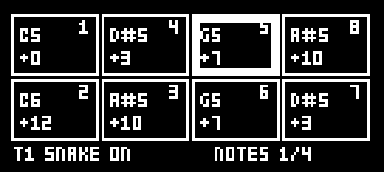
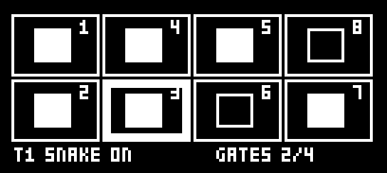
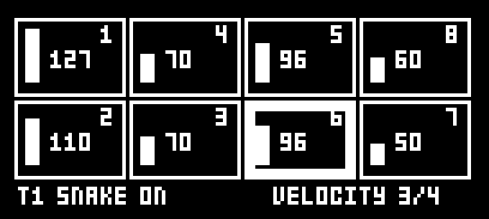
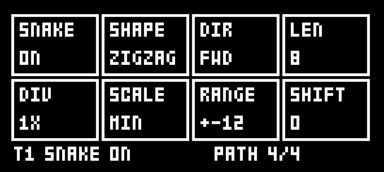
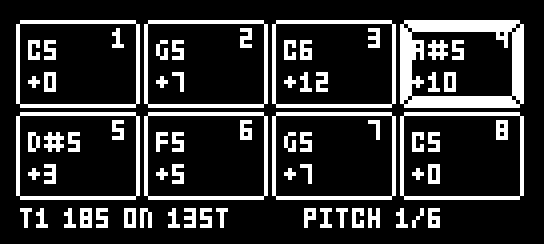
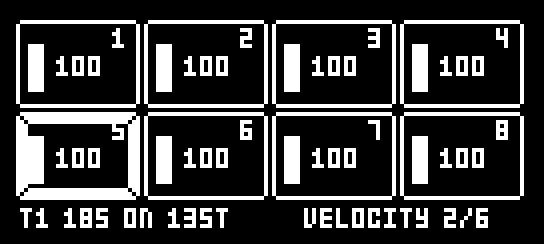
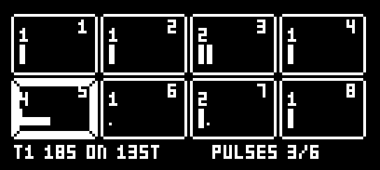
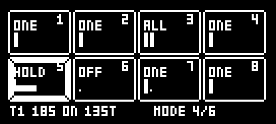
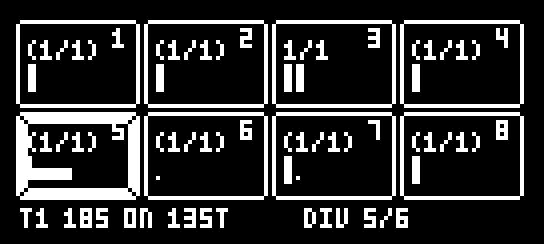
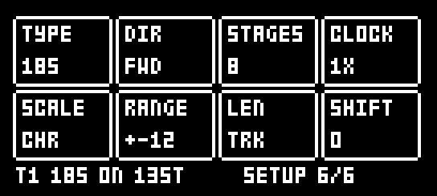

# DIGISEQ for Digitone

**This is the Digitone version**, for the Elektron Digitone mk1 and Digitone Keys. There is no Digitakt
version yet; [DIGISNAKE for Digitakt](https://github.com/ClaidArremer/digitakt-digisnake) has SNAKE on the
Digitakt.

Sequencer types for the **Elektron Digitone mk1**, as an [elekloader](https://github.com/irpina/elekloader)
mod (id `digiseq`). Each track picks its own **TYPE** and plays it in place of its own trigs, so T1 can play
SNAKE, T2 185, and T3 its own trigs, on the four synth tracks and the four MIDI tracks alike.

- **SNAKE**: a Cartesian sequencer after Maxime Dangles' MDD Snake and Make Noise's René. Eight cells in a
  4 × 2 grid that matches knobs A–H, walked by a path. This is DIGISNAKE 1.3, and DIGISNAKE projects load as
  they were.
- **185**: a stage sequencer after **ML-185** (Nico Starke's free Max for Live device, itself after RYK's
  M-185 for the Roland System 100m). Eight stages, each with a pitch, a velocity, a **length of 1–8 clock
  pulses** (how long the stage plays before the next) and a **mode**: rest, one note, a note every pulse, or
  one note held for the whole stage.

By Robbie (designed and tested on a Digitone mk1, OS 1.44). GPL-2.0-or-later.

> Unofficial and unsupported. Flashing modified firmware is at your own risk; the stock Digitone OS always
> recovers the unit (send the stock .syx from the boot menu).

## What you need

| | |
|---|---|
| Unit | Digitone mk1 or Digitone Keys |
| OS | **1.44**. A 1.43 build is included, untried; on 1.43 there are no drop-down messages and settings are not kept over a power cycle |
| Mods | elekloader's **core-dn1** (3.3 or later; **4.1.1** with DIRECT JUMP or PUMP in the build) and **seq-events 0.2**, included here in `elemods/` |
| Not with | **DIGISNAKE**: DIGISEQ replaces it (it uses the same page and the same project data) |

seq-events 0.2 is elekloader's seq-events with one new event, `ev_fire_len`, which lets a mod set the length
of the note a step plays. 185's held stages need it. Mods built for seq-events 0.1 work with 0.2.

## Install

In the elekloader app, add both files for your OS from `elemods/`: `digiseq-0.2-os1.44.elemod` and
`seq-events-0.2-os1.44.elemod` (or the two `-os1.43` files). Untick DIGISNAKE and any older seq-events, keep
the app's core-dn1 ticked, build, and send the firmware to the Digitone. From the command line:

```
python -m elekloader.patch --stock Digitone_and_Digitone_Keys_OS1.44.syx \
  --mod core-4.1.1-os1.44.elemod --mod elemods/seq-events-0.2-os1.44.elemod \
  --mod elemods/digiseq-0.2-os1.44.elemod --out Digitone_digiseq.syx
```

## Opening it and choosing a type

Press **TRIG** twice: DIGISEQ is the page after the stock TRIG page. Its last page's knob A is **TYPE**:
**OFF**, **SNAKE** or **185**. Hold **TRIG + UP / DOWN** to step through the types from any page. With a type
on, the track plays it in place of its own trigs; lock trigs still play. OFF keeps every type's settings, so
the pages still show and edit the last type, and switching back finds it as you left it.

Everything is per track, saved with the project, and on OS 1.44 kept over a power cycle.

## SNAKE

| NOTES | GATES |
|---|---|
|  |  |
| **VELOCITY** | **PATH** |
|  |  |

SNAKE works as DIGISNAKE 1.3 does (see [DIGISNAKE for Digitone](https://github.com/ClaidArremer/digitone-digisnake)),
with one change: PATH's knob A is TYPE instead of SNAKE on/off (the screenshots above are DIGISNAKE's).

| Page | Knobs A–H | Also |
|---|---|---|
| NOTES | Each cell's note, −24 to +24 semitones from the track's NOTE, quantised to SCALE | UP / DOWN: all a semitone (FUNC: an octave) |
| GATES | Each cell plays or rests | Trig keys 1–8 toggle a cell. UP / DOWN: rotate |
| VELOCITY | Each cell's velocity, 1–127 | UP / DOWN: all up or down |
| PATH | TYPE, SHAPE, DIR, LEN, DIV, SCALE, RANGE, SHIFT | |

## 185

| PITCH | VELOCITY |
|---|---|
|  |  |
| **PULSES** | **MODE** |
|  |  |
| **DIV** | **SETUP** |
|  |  |

The pages as DIGISEQ draws them, playing (the thick frame is the stage playing); the Digitone's own title
bar sits above. Knobs A–H are stages 1–8. Each stage box shows its pulses as a row of slots: a tall tick is a
note, a dot a silent pulse, a bar a held note, and the line underneath the pulse playing.

The sequence plays the stages in turn. Each stage lasts its **PULSES** in clock pulses (a pulse is a step at
CLOCK 1X), then the next stage starts. What a stage plays depends on its **MODE**:

| MODE | What the stage plays |
|---|---|
| OFF | Nothing: a rest as long as the stage |
| ONE | One note on the stage's first pulse |
| ALL | A note on every pulse, or with DIV 2–4 every 2nd, 3rd or 4th pulse (a ratchet or a run of repeats) |
| HOLD | One note on the first pulse, held for the whole stage |

| Page | Knobs A–H | Also |
|---|---|---|
| PITCH | Each stage's note, −24 to +24 semitones from the track's NOTE, quantised to SCALE | UP / DOWN: all a semitone (FUNC: an octave). FUNC + knob: −24 / −12 / 0 / +12 / +24 |
| VELOCITY | Each stage's velocity, 1–127 | UP / DOWN: all up or down. FUNC + knob: 1 / 32 / 64 / 96 / 127 |
| PULSES | Each stage's length, 1–8 pulses | UP / DOWN: all one longer or shorter |
| MODE | Each stage's mode | Trig keys 1–8: that stage's next mode. UP / DOWN: rotate the modes |
| DIV | ALL's division, 1–4: a note every 1st, 2nd, 3rd or 4th pulse (shown in brackets on stages that are not ALL) | UP / DOWN: all |
| SETUP | The settings below | |

| Knob | SETUP | Values |
|---|---|---|
| A | TYPE | OFF, SNAKE, 185 |
| B | DIR | FWD, BWD, F/B, B/F, RND (RND picks the next stage at random when a stage ends) |
| C | STAGES | How many stages the sequence plays, 1–8. Stages after it are drawn with corners only |
| D | CLOCK | 1/8, 1/4, 1/2, 1X, 2X: steps a pulse. 2X runs the track at twice its own speed and needs the pattern's SCALE set to per track, as SNAKE's DIV 2X does |
| E | SCALE | CHR, MAJ, MIN, DOR, PHR, LYD, MIX, HMIN, PENT, mPNT, BLUE, WHOL, in the keyboard's ROOT |
| F | RANGE | The spread of randomised pitches, ±1–24 semitones |
| G | LEN | The length of ONE and ALL notes: TRK (the track's LEN), 1/32, 1/16, 1/8, 1/4. HOLD notes always last their stage |
| H | SHIFT | Which stage the sequence starts on, 0–7 |

The bottom line shows the sequence's length in steps (13ST: 13 steps), which may not match the pattern's, so
it drifts against the pattern as a polymeter. New projects start with a little demo line on 185.

## Keys

PAGE is the TRIG key, held. On OS 1.44 every action shows the stock drop-down message.

| Keys | What happens |
|---|---|
| PAGE + UP / DOWN | The next / previous TYPE |
| PAGE + YES | Randomise the page shown (SNAKE's PATH: all but TYPE and SCALE; 185's SETUP: DIR, STAGES, RANGE and SHIFT) |
| PAGE + NO | Back to how the track was when PAGE went down, a print included. No redo |
| PAGE + PLAY | Clear the page shown |
| PAGE + REC | Copy the page shown |
| PAGE + STOP | Paste it onto this track (only onto a track of the same type) |
| PAGE + FUNC + REC | **Print**: write what the track plays into its own trigs, notes and velocities over the track's length (185: held and LEN-set notes as LEN locks), then set TYPE to OFF |
| FUNC + YES | Randomise the note pages together (SNAKE: NOTES, GATES, VELOCITY; 185: PITCH, VELOCITY, PULSES, MODE) |
| FUNC + NO | Back to before the last run of FUNC + YES |
| FUNC + knob | Jump to preset values (pitches, velocities, RANGE) |

Print keeps lock trigs and parameter locks, clears the micro timing and trig condition of each step it writes a note to, and a 2X track stays at 2X. With DIR on RND it freezes one run.

## With DIRECT JUMP

With [DIRECT JUMP for Digitone](https://github.com/ClaidArremer/digitone-directjump) 1.4 or later in the build,
a pattern started by its START ON BAR starts every track's sequence from the beginning too, SNAKE and 185
alike. A legato jump leaves them playing on.

## Differences from ML-185

- Pitches are relative to the track's NOTE (so transposing the track transposes the sequence) and can be
  quantised to a scale. Pitch, velocity and length are per stage; there is no Aux (CC) layer.
- CLOCK goes from 1/8 to 2X of the track's own step, rather than 1/32 to 1/8 of a bar.
- Swing is the Digitone's own.
- B/F (back and forth starting backwards) and SHIFT are new; the fixed sequence length mode is not here
  (STAGES sets the length).

## Changes

- **0.2**: PRINT puts each printed note on its step with no trig condition, so a trig left there from before
  can no longer shift it (micro timing) or mute it on some loops (a condition such as 1:2). Steps a type plays
  ignore the track's own trigs' conditions and probabilities.
- **0.1**: the first version: SNAKE (from DIGISNAKE 1.3) and 185. Run in an emulator (digiemu), then played on a
  Digitone mk1 (OS 1.44) with PUMP 2.10, DIRECT JUMP 1.5, DIGICOMPLEX, DH-101, digihealth and LØST LVLS.

## How it works

DIGISEQ uses seq-events' step-fire events: `ev_gen_trig` decides whether a step fires, `ev_gen_notes` its
note, `ev_fire_vel` its velocity and `ev_fire_len` its length, so the stock sequencer plays everything
(timing, locks, the machine). A HOLD sets its note's LEN to the stage's length in steps. The LEN values were
measured on the TRIG page: index 14 is one step (1/16), 30 two (1/8), 46 four, 62 eight, 78 sixteen.

The page is a core-dn1 mod page after the TRIG page (page 28 for synth tracks, 29 for MIDI tracks). The
settings are core-dn1 project data: `SNK1` and `SNK2` for SNAKE (DIGISNAKE's own, so its projects load) and
`DSQ1` and `DSQ2` for TYPE and 185. On OS 1.44 an edit asks the OS to refresh its power-up copy of the
project. No firmware address is named in the C source except the drop-down message and the power-up copy on
1.44 (`mod.json`'s 1.44 port).

`ev_fire_len` is new in seq-events 0.2: two code sites, one in each of the Digitone's step fires (the synth
tracks' and the MIDI tracks'), where the fire reads a step's LEN (its lock, else the track's LEN). The change
to elekloader's source is in `seq-events/ev_fire_len.patch`; it is offered to elekloader as a pull request.

## Building

With elekloader (with the seq-events patch applied) and an m68k cross GCC on the path:

```
python -m elekloader.sdk.build --stock Digitone_and_Digitone_Keys_OS1.44.syx .
```

## Credits and third-party code

DIGISEQ is Robbie's own work, written with Claude (Anthropic); every line of `digiseq.c` is new (SNAKE's from
DIGISNAKE, also Robbie's). The ideas come from **MDD Snake** (Maxime Dangles' free Max for Live device), **Make
Noise René**, **ML-185** (Nico Starke's free Max for Live device) and **RYK's M-185**; no code from any of them.
The random numbers use Marsaglia's xorshift, a public algorithm.

DIGISEQ builds against irpina's [elekloader](https://github.com/irpina/elekloader) SDK headers and runs on its
core-dn1 and seq-events (GPL-2.0-or-later). core-dn1 is not included here. seq-events is: the two
`elemods/seq-events-0.2-*.elemod` files are builds of elekloader's `mods/seq-events-dn1` (GPL-2.0-or-later, by
elekloader's contributors) from
[its source at commit b9006bf](https://github.com/irpina/elekloader/tree/b9006bf8b7c4e69becd7e2f16ec6b20ea52b8982/mods/seq-events-dn1)
with `seq-events/ev_fire_len.patch` applied (the new event). They carry only that mod's own code and no
Elektron code. The firmware addresses in `mod.json` and the patch, and the pattern layout DIGISEQ prints into,
were found by studying the Digitone's own OS so the mod can work with it; no Elektron code is included.

## Trademarks

Elektron, Digitone and Digitakt are trademarks of Elektron Music Machines; Make Noise and René of Make Noise;
Roland and System 100m of Roland Corporation; Max for Live of Ableton AG and Cycling '74. They are named only
to say what this works with or was inspired by. This project is not affiliated with or endorsed by any of them.

## Licence

GPL-2.0-or-later, see [LICENSE](LICENSE).
